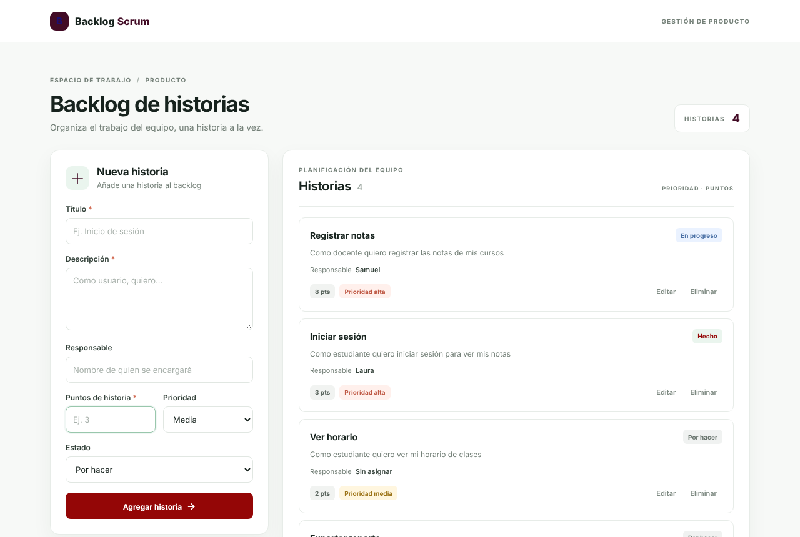
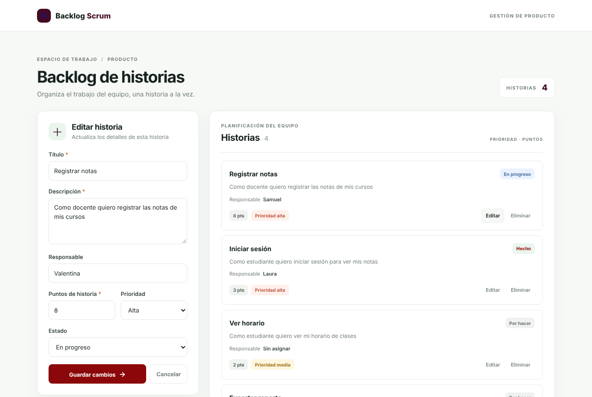
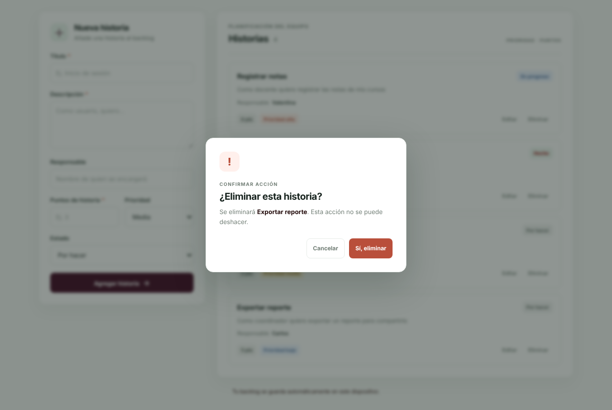
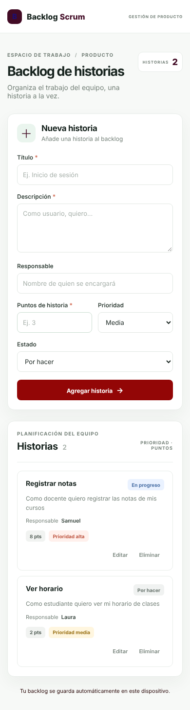

# Backlog Scrum · CRUD de historias de usuario

Aplicación web para gestionar el **backlog de historias de usuario** de un equipo Scrum. Permite crear, ver, editar y eliminar historias con su responsable, puntos de historia, prioridad y estado. Los datos se guardan en el navegador con `localStorage`, por lo que no necesita servidor ni base de datos.

Trabajo práctico del seminario **Gestión de Software Ágil asistido por Inteligencia Artificial**
Samuel Felipe Losada Rojas · Ingeniería de Software · Fundación Escuela Tecnológica de Neiva (FET)
Docente: Camilo Morales Vargas

🎥 **Video explicativo:** [VER VIDEO](ENLACE_DEL_VIDEO)

---

## Funcionalidades

| Operación | Qué hace |
|---|---|
| **Create** | Agrega una historia desde el formulario. El título, la descripción y los puntos son obligatorios. |
| **Read** | Muestra las historias ordenadas por prioridad (alta → media → baja) y, dentro de cada una, por puntos de mayor a menor. |
| **Update** | El botón *Editar* carga la historia en el formulario y *Guardar* aplica los cambios. |
| **Delete** | El botón *Eliminar* abre una ventana propia de confirmación antes de borrar. |

Además:
- Campo **Responsable** para saber quién del equipo tiene cada historia («Sin asignar» si está vacío).
- Contador de historias.
- Los datos se conservan al recargar la página (`localStorage`).
- El texto se inserta como texto y no como HTML, lo que evita la inyección de código (XSS).
- Diseño adaptable a celular.

## Tecnologías utilizadas

- HTML5
- CSS3
- JavaScript (sin librerías)
- localStorage del navegador
- GitHub Copilot (modo Agent) en Visual Studio Code como asistente de IA

## Estructura del proyecto

```
backlog-scrum-crud/
├── index.html        # Estructura de la página: formulario, lista y ventana de confirmación
├── css/
│   └── styles.css    # Estilos, colores y diseño responsive
├── js/
│   ├── storage.js    # Capa de datos: leer y guardar historias en localStorage
│   └── app.js        # Lógica del CRUD: eventos, validación, orden y renderizado
└── screenshots/      # Capturas usadas en este README
```

## Cómo ejecutarlo

1. Clona o descarga el repositorio:
   ```bash
   git clone https://github.com/samuellosadaro-cmyk/backlog-scrum-crud.git
   ```
2. Abre el archivo `index.html` en el navegador (doble clic).

También se puede abrir con la extensión **Live Server** de VS Code: clic derecho sobre `index.html` → *Open with Live Server*.

## Capturas de pantalla

**Backlog con historias ordenadas por prioridad**


**Editando una historia**


**Ventana de confirmación para eliminar**


**Vista en celular**



## Prompts utilizados

Herramienta: **GitHub Copilot**, chat en modo *Agent* dentro de Visual Studio Code (18 de noviembre de 2026). Los prompts se muestran en el video tal como se enviaron.

### Prompt 1: generar el CRUD

> hola, necesito hacer un CRUD para un trabajo de la universidad. es un backlog de historias de usuario como el que usa un equipo scrum. cada historia tiene título, descripción, puntos de historia, prioridad (alta, media, baja) y estado (por hacer, en progreso, hecho). quiero poder crear, ver, editar y eliminar historias, y que se guarden en localStorage. usa solo html, css y javascript en los archivos index.html, css/styles.css, js/storage.js y js/app.js. ponle comentarios al código para entenderlo

**Qué pedí y para qué:** la primera versión de la aplicación. Describí los datos de cada historia, las cuatro operaciones del CRUD, el uso de localStorage y la estructura de archivos, y pedí comentarios para poder entender y explicar el código. Copilot generó los cuatro archivos.

### Prompt 2: campo Responsable

> agrégale un campo de "Responsable" para saber quién del equipo tiene cada historia, que salga en el formulario y en la lista y que se pueda editar. explícame qué cambiaste en cada archivo

**Qué pedí y para qué:** en un equipo ágil cada historia debe tener un responsable. Pedí el campo en el formulario, en la lista y en la edición, y que me explicara los cambios para entenderlos.

### Prompt 3: ordenar por prioridad

> ahora quiero que la lista se ordene por prioridad, primero las de prioridad alta, luego media y al final baja. y si tienen la misma prioridad que se ordenen por puntos de mayor a menor

**Qué pedí y para qué:** que el backlog se vea como debe verse en Scrum, con lo más importante arriba. Copilot agregó el ordenamiento en `app.js` sin modificar los datos guardados.

### Prompt 4: ventana para eliminar

> cuando elimino una historia quiero que salga una ventana con estilo que pregunte si de verdad la quiero borrar, en vez del aviso feo del navegador

**Qué pedí y para qué:** mejorar la experiencia de uso. Copilot cambió el `confirm()` del navegador por una ventana propia con botones *Cancelar* y *Sí, eliminar*.

## Cambios propios sobre el código generado

- Cambié los colores principales de la aplicación en `css/styles.css` (variables `--green` y `--green-dark`) por un tono vinotinto, para darle mi propio estilo.
- Probé cada cambio en el navegador después de cada prompt: crear, editar, eliminar, el orden por prioridad y que los datos se conserven al recargar.

## Uso responsable de la IA

El código fue generado con ayuda de GitHub Copilot y luego revisado, probado y ajustado por el autor, que entiende y puede explicar cada parte. Los prompts de este README son los que se usaron realmente durante el desarrollo, como se ve en el video.
